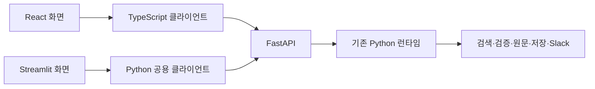

# React 전환과 기능 인수 기준

FastAPI와 Python 런타임을 유지하고 UI를 React + TypeScript + Vite로 단계적으로 전환합니다. 이 문서는 기존 기능의 인수 기준과 현재 React 지원 범위의 정본입니다. 용어는 [GLOSSARY.md](../GLOSSARY.md), 서버 계약은 [런타임 참고 문서](runtime_reference.md#5-api-계약)를 따릅니다.

## 1. 현재 범위와 단계

React 정적 빌드는 FastAPI의 `/app/`에서 제공하며, 서비스 관리자의 기본 UI는 React입니다. 기존 Streamlit은 `--ui streamlit`로 선택하는 복귀 경로로 유지합니다. 두 UI는 같은 FastAPI와 Python 도메인 실행을 사용합니다. 기능의 구현 상태와 검증 범위는 아래 항목별로 구분하며, 화면에 없는 기능을 API가 지원한다는 이유만으로 이식 완료로 보지 않습니다.

React 화면은 ChatGPT·Claude·Gemini의 대화 화면 패턴을 참고해 대화 탐색과 중앙 입력창에 집중합니다. 첫 화면은 제목과 짧은 설명, 입력창, 질문 예시 2개 순서로 배치하고, 대화가 시작되면 입력창을 화면 하단에 유지합니다. 지원 문서와 첨부 형식·용량은 사이드바 하단의 ‘사용 안내’에서 펼쳐 봅니다. 사이드바는 새 채팅·검색·최근 대화를 먼저 보여 주고, 확정 파일 목록은 ‘첨부 자료’에서 확인합니다. 테마와 Slack 수신자는 ‘설정’ 안에서 변경합니다. 입력창의 `+`로 선택한 파일과 서버에서 확정한 첨부 목록을 구분하며, 예시 선택은 기존 작성 초안을 덮어쓰거나 전송하지 않습니다. [화면 흐름 브라우저 검사](../frontend/tests/e2e/ui-parity.spec.ts)는 첫 화면의 정렬·입력 순서·예시·사용 안내·파일 선택과 확정 목록·좁은 모바일 화면과 메뉴를 실제 Chromium에서 확인합니다.

대화 화면은 상단의 대화 제목, 오른쪽 사용자 발화, 카드 배경 없이 읽는 답변 본문, 하단의 후속 질문 입력창으로 구성합니다. 정상 완료 상태는 스크린리더용으로 제공하고, 부분 답변·실패·근거 누락과 원문 불일치 안내는 화면에 표시합니다. 본문의 작은 인용 번호는 해당 절의 근거를 열며, 답변 아래에는 실제 사용한 고유 근거·TXT 저장·‘답변 정보’를 한 줄의 보조 기능으로 모읍니다. 좁은 화면이나 긴 저장 안내에서는 줄바꿈합니다. 검증 집계와 요청 ID는 기본으로 접힌 ‘답변 정보’에 포함하고, 답변 본문이 없는 실패 등은 기존 ‘요청 정보’에서 요청 ID를 확인합니다. 저장·전송의 실제 결과와 답변의 한계는 상세를 펼치지 않아도 볼 수 있습니다. 코드와 표는 좁은 화면에서도 대화 영역을 넓히지 않고 읽을 수 있어야 합니다. 새 질문을 명시적으로 제출하면 해당 질문으로 이동하지만, 답변이 도착하거나 초안을 입력할 때는 읽는 위치를 유지합니다. [대화 화면 브라우저 검사](../frontend/tests/e2e/conversation-layout.spec.ts)는 요청 ID의 접기·펼치기, 여러 답변 뒤의 코드·표 표시, 후속 작성 초안의 유지와 제출한 질문의 노출을 확인합니다.

사이드바의 대화 검색은 이 탭에 보관한 모든 대화 제목을 대상으로 하며, 검색하거나 대화를 선택해도 요청을 실행하지 않습니다. 답변을 기다릴 때는 답변 자리에서 서버가 보낸 진행 단계를 표시합니다. 긴 답변의 끝이 화면 아래에 있으면 ‘최신 답변’ 버튼을 제공하고, 사용자가 누를 때만 아래로 이동해 입력창으로 포커스를 돌려줍니다. 코드 블록의 ‘코드 복사’는 공백과 개행을 포함한 본문을 그대로 복사합니다. 근거 패널은 출처 유형·확보한 원문 위치·수집 한계와 사용한 발췌를 우선 보여 주고, 연결된 답변·수집 정보·전체 원문은 카드 대신 간결한 펼침 항목으로 제공합니다. 일치 범위는 본문을 읽기 쉬운 중립색으로 강조하며, 비표 자료의 ‘발췌 복사’와 ‘보관 원문 복사’를 구분합니다. 클립보드 사용이 제한된 환경에서는 수동 복사 안내를 표시합니다.



화면 상태와 브라우저 전송은 React가 소유하고, 세션·답변·행동의 도메인 계약은 기존 서버가 유지합니다. 두 클라이언트는 생성 스키마와 공통 응답 사례로 계약을 함께 검증합니다.

| 단계 | 범위 | 현재 상태 | 완료 기준 |
|---|---|---|---|
| 1 | 기존 기능·HTTP/SSE 계약·검증 경계 정리 | 기준 확정 | 아래 모든 항목에 기존 근거와 담당 단계가 있음 |
| 2 | React 기반, 공개 설정, TypeScript API 클라이언트, 기본 질문 흐름 | 구현·검증 완료 | 타입·계약·UI 검사와 실제 FastAPI 연결, 기존 앱 회귀 통과 |
| 3 | 브라우저 파일 수신, 첨부 선택·검토·확정·복구 | 구현·HTTP·브라우저 검증 | 브라우저 파일부터 실제 manifest·원본 바이트까지 검증 |
| 4 | 여러 대화, 작성 초안, 복원, 만료·중단·실패 복구 | 구현·UI·브라우저 검증 | 대화별 격리와 원문 보존, 자동 재실행 방지 |
| 5 | 구조화 답변·인용·원문 근거·부분 답변 | 구현·컴포넌트·브라우저 검증 | 본문·원문·인용 연결·한계 보존, 병합 표의 검증 범위는 아래에 별도 명시 |
| 6 | 선택 답변 저장·다운로드·Slack 전달 | 구현·HTTP·브라우저 검증 | 원본 답변 보존과 행동별 결과·중복 실행 방지 |
| 7 | 전체 브라우저 검증, 정적 제공, 기본 UI 전환·Streamlit 복귀 경로 유지 | 구현·브라우저·실행 계약 검증 | 전체 인수 항목·설치·실행·복귀 절차 통과 |

1단계의 기준 코드는 `a8d198af`입니다. 이후 기능을 추가하거나 계약을 바꿀 때는 해당 ID의 기준·검증·상태를 함께 갱신합니다. 검증 통과 여부는 실제 명령의 결과로 판단하며 테스트 개수 자체를 완료 기준으로 사용하지 않습니다.

## 2. 기능 인수 기준

`검증`은 연결된 새 테스트의 범위에서 확인한 항목입니다. 컴포넌트·위치 로직 검사와 실제 브라우저 검사는 구분합니다. 기본 렌더링이나 서버 API만 있다는 이유로 화면 기능의 검증을 대신하지 않습니다. 실제 외부 서비스·운영 프로세스·문서 파서와 접근성의 추가 검증 범위는 아래에 명시합니다. 각 항목의 기존 테스트 링크는 관찰 가능한 동작의 근거입니다. 전체 테스트를 내부 호출 단위로 번역하기보다 같은 사용자 결과를 새 환경에서 검증합니다.

### API와 질문 실행

| ID | 관찰 가능한 인수 기준 | 기존 근거 | 단계·상태 |
|---|---|---|---|
| API-01 | 공개 설정의 지원 형식·파일 개수·바이트 한도·질문 문자 수와 UTF-8 바이트 상한은 실제 서버 설정과 일치한다. 키·토큰·서버 파일 경로는 응답에 없다. | [지원 형식](../src/core/upload_formats.py), [기존 입력 제한](../src/app/web/streamlit_app.py) | 2단계 검증 |
| API-02 | 요청·최종 응답·SSE 이벤트 타입은 서버 계약에서 생성한다. 생성 결과가 서버와 달라지면 검사에서 실패한다. 스키마에 표현되지 않는 상태별 조건도 검증한다. | [응답 모델](../src/app/web/schemas.py), [턴 결과 조건](../src/core/contracts/outcome.py) | 2단계 검증 |
| API-03 | `completed`·`partial`·`needs_input`·`failed`·`refused`를 구분한다. HTTP 200이나 `done`만으로 성공하지 않는다. `error` 뒤 유효한 최종 응답이 오면 앞선 오류와 최종 결과를 보존한다. | [API 계약](../src/app/web/routes.py), [공용 클라이언트](../src/app/client.py) | 2단계 검증 |
| API-04 | 한글 UTF-8 문자·SSE 프레임이 청크 경계에서 나뉘어도 같은 결과를 얻는다. 유효한 최종 응답 전에 잘린 UTF-8·JSON·마지막 프레임이나 종료를 만나면 완료로 보지 않는다. 유효한 최종 응답을 받으면 확정하고 뒤의 `done`을 기다리지 않는다. | [스트림 회귀](../tests/app/test_client.py), [SSE 파서](../src/infra/sse.py) | 2단계 검증 |
| API-05 | 연결 실패·무응답 읽기 시간 초과·중단·리다이렉트에서 질문 POST를 자동 재전송하지 않는다. 읽기 제한은 질문 전체 실행 시간이 아니라 데이터 수신이 없는 시간을 기준으로 한다. 수신 중단을 서버 실행 취소라고 안내하지 않는다. | [스트림 회귀](../tests/app/test_client.py), [수신 중단](../tests/app/test_streamlit_workflow.py) | 2단계 검증 |
| API-06 | 확인되지 않은 manifest와 확인된 빈 첨부 목록을 구분한다. 확인 실패나 응답 유실 후에는 다음 질문 전에 GET으로 재확인하며, 조회 실패 시 질문을 시작하지 않는다. | [공용 클라이언트](../src/app/client.py), [대화 연결 확인](../tests/app/test_streamlit_conversations.py) | 2단계 검증 |
| API-07 | 질문 입력 → 명시적 전송 → 진행 상태 → 최종 결과가 실제 FastAPI를 통해 연결된다. 질문의 앞뒤 공백과 개행을 보존한다. 실패·거절·추가 입력 필요를 정상 답변으로 표시하지 않는다. | [질문 원문·진행 처리](../tests/app/test_streamlit_workflow.py) | 2단계 검증 |

### 첫 화면·대화·작성 초안과 복구

| ID | 관찰 가능한 인수 기준 | 기존 근거 | 단계·상태 |
|---|---|---|---|
| CHAT-01 | 첫 안내를 검증된 답변으로 표시하지 않는다. 질문 예시는 초안만 채우고 전송하지 않으며, 클릭 직전 입력한 내용도 덮어쓰지 않는다. 첨부 예시는 확인된 첨부에 맞고 변경 검토 중에는 숨긴다. | [첫 화면·예시 테스트](../tests/app/test_streamlit_workflow.py) | 4·UI 검증 |
| CHAT-02 | 새 대화와 최근·전체 대화를 오가도 메시지, 정확한 초안, 보류 질문, Slack 입력과 확정 첨부가 해당 대화에 남는다. 전환만으로 작업을 실행하지 않는다. | [대화 격리](../tests/app/test_streamlit_conversations.py), [전체 대화 선택](../tests/app/test_streamlit_sidebar.py) | 4·UI·브라우저 검증 |
| CHAT-03 | 답변 수신 중 다음 초안을 작성하고 다른 대화를 볼 수 있다. 해당 대화의 추가 전송·첨부 변경·TXT 저장은 막는다. 첨부 준비·TXT 저장 중 전환 제약은 유지한다. | [진행 중 탐색](../tests/app/test_streamlit_workflow.py), [대화 상태](../src/app/web/streamlit_state.py) | 4·UI 검증 |
| CHAT-04 | 같은 탭에서 전송 전·제출 직후·응답 대기 중 새로고침해도 대화·당시 근거·정확한 초안을 복원한다. 중단된 질문은 기록으로 남고 자동 전송되지 않는다. | [복원 테스트](../tests/app/test_streamlit_conversations.py), [제출 직후 저장](../tests/browser/streamlit_browser_state.test.mjs) | 4·상태·브라우저 검증 |
| CHAT-05 | epoch 변경 시 기록·초안·당시 근거를 읽기 전용으로 보존한다. 연결 확인 실패는 만료와 구분하고 재확인을 제공한다. 저장소 손상·저장 실패는 안내하고 새 대화를 시작할 수 있다. | [만료·연결·저장소 실패](../tests/app/test_streamlit_conversations.py) | 4·상태·브라우저 검증 |
| CHAT-06 | 수신 중단 뒤 늦게 온 결과가 다음 질문이나 다른 대화를 덮어쓰지 않는다. 최신 실패의 수정은 초안만 채운다. 전달이 이미 실행됐거나 불명인 요청 전체를 재전송하지 않는다. | [중단·늦은 응답·재시도](../tests/app/test_streamlit_workflow.py) | 4·UI·브라우저 검증 |
| CHAT-07 | Enter 제출·Shift+Enter 줄바꿈 등 기존 작성 동작을 유지한다. 제출하지 않는 키·마우스 입력이 초안을 지우거나 파일을 제출하지 않는다. | [브라우저 상태 테스트](../tests/browser/streamlit_browser_state.test.mjs), [브라우저 검증 절차](runtime_reference.md#8-테스트-및-검증) | 4·UI 검증 |

### 파일 선택·첨부 확정

| ID | 관찰 가능한 인수 기준 | 기존 근거 | 단계·상태 |
|---|---|---|---|
| UPLOAD-01 | 전송 대기·업로드 중·선택 오류와 서버의 검색 가능한 첨부를 구분한다. 대화 왕복 시 파일 선택과 초안을 복원한다. 새로고침 뒤 선택 파일은 다시 골라야 한다. 같은 이름의 정상·오류 파일도 구분한다. | [파일 선택 브라우저 검사](../tests/browser/streamlit_ux_checks.mjs), [선택 상태 테스트](../tests/browser/streamlit_browser_state.test.mjs) | 3·상태·UI 검증 |
| UPLOAD-02 | 같은 내용의 기존 첨부는 유지하고 같은 이름의 다른 내용은 명시적 교체 검토를 거친다. 개별 삭제·전체 해제 뒤에도 과거 답변과 인용을 보존한다. | [업로드 요청 준비](../tests/app/test_uploads.py), [첨부 HTTP 흐름](../tests/web/test_multi_upload_api.py) | 3·HTTP·브라우저 검증 |
| UPLOAD-03 | 파일과 질문의 최초 제출에서 첨부가 성공하면 그 질문을 한 번 보낸다. 첨부 실패 시 질문·기존 자료를 유지하고, 재시도 성공 뒤에는 보류 질문의 명시적 전송을 기다린다. 복구 선택은 작성창만 복원한다. | [첨부 실패·질문 복구](../tests/app/test_streamlit_workflow.py), [첨부 확정 처리](../src/app/web/streamlit_requests.py) | 3·4·UI·브라우저 검증 |
| UPLOAD-04 | 파일만 전송하면 첨부만 확정한다. 최근 질문의 미해결 정보가 첨부일 때만 `이전 질문 계속하기`를 제공하며, 클릭 전 재전송하지 않고 별도로 작성한 다음 초안을 보존한다. | [파일만 전송·명시적 계속](../tests/app/test_streamlit_workflow.py) | 3·4·UI 검증 |
| UPLOAD-05 | 이전 epoch·revision, 다른 세션 파일, 변경된 바이트·해시를 거절한다. 실패한 묶음은 이전 확정 자료를 유지한다. 응답 유실 뒤 같은 operation 재시도는 중복 확정하지 않는다. | [첨부 API 계약](../tests/web/test_multi_upload_api.py) | 3·HTTP 검증 |

### 답변·인용·원문과 한계

| ID | 관찰 가능한 인수 기준 | 기존 근거 | 단계·상태 |
|---|---|---|---|
| ANSWER-01 | 문단·제목·목록·코드·표를 구조에 맞게 표시하고 코드의 공백·줄바꿈·들여쓰기와 원문 문자열을 보존한다. 표시용 변환이 본문·export를 바꾸지 않는다. | [본문 표시](../tests/app/test_answer_scope_ui.py), [정확한 코드 문맥](../tests/app/test_streamlit_sources.py) | 5·컴포넌트 검증 |
| ANSWER-02 | 본문 인용은 해당 답변의 해당 근거를 연다. 같은 이름·번호가 다른 답변에 있어도 섞이지 않는다. 첨부가 바뀐 뒤에도 당시 보관 원문을 보여 준다. | [인용 연결·반복 답변](../tests/app/test_answer_scope_ui.py), [첨부와 버전별 답변](../tests/web/test_multi_upload_api.py) | 5·컴포넌트·브라우저 검증 |
| ANSWER-03 | 확보한 줄·Notebook 셀·페이지·수집 범위만 표시하고 모르는 위치를 추정하지 않는다. 코드 CRLF·물리 줄과 표의 병합·선택 셀을 보존한다. 내용 hash를 문서 버전으로 오인시키지 않는다. | [원문 위치·표시 테스트](../tests/app/test_streamlit_sources.py), [표 원문](../src/app/web/streamlit_sources.py) | 5·표시·위치 로직·브라우저 검증 |
| ANSWER-04 | 근거에서 발췌를 먼저 보고 전체 발췌·연결된 답변·원문·수집 정보를 펼칠 수 있다. 발췌 내 검색은 원문과 선택 범위를 바꾸지 않는다. 현재 출처 링크와 당시 원문을 구분한다. | [발췌 미리보기·검색·현재 링크](../tests/app/test_streamlit_sources.py) | 5·컴포넌트 검증 |
| ANSWER-05 | 부분 답변의 범위·부족한 정보·다음 행동을 요약하고 접힌 상세에도 한계를 보존한다. 원문 연결 실패 경고는 해당 내용 가까이 남긴다. 본문 미완성과 저장·전송 실패를 구분한다. | [부분 답변·근거 경고·저장 실패](../tests/app/test_answer_scope_ui.py) | 5·6·컴포넌트 검증 |
| ANSWER-06 | 원문 Markdown과 연결된 답변 문맥에서 HTML을 실행하지 않는다. 상대 문서 링크는 수집 페이지 기준으로 해석하며 코드와 보관 원문을 다시 쓰지 않는다. | [Markdown·링크·원문 보존](../tests/app/test_streamlit_sources.py) | 5·컴포넌트 검증 |
| ANSWER-07 | 원문 연결 검사·직접 발췌 일치·의미 검증의 뜻을 구분한다. 모델 확률을 전체 답변의 정확도나 코드 실행 성공으로 표시하지 않는다. 로그 같은 출력 형식을 프로그램 코드라고 단정하지 않는다. | [검사 의미·형식 안내](../tests/app/test_answer_scope_ui.py) | 5·컴포넌트 검증 |

### 저장·Slack 전달

| ID | 관찰 가능한 인수 기준 | 기존 근거 | 단계·상태 |
|---|---|---|---|
| ACTION-01 | 선택한 답변의 `answer_id`로 TXT를 만든다. 과거 답변도 그 본문·출처·한계를 저장하며 다운로드 바이트는 서버 산출물과 같다. 답변을 다시 생성하지 않는다. | [직접 저장·다운로드](../tests/web/test_answer_exports.py), [UI 저장](../tests/app/test_streamlit_workflow.py) | 6·HTTP·브라우저 검증 |
| ACTION-02 | 저장 실패는 같은 답변·저장 작업으로 재시도한다. 준비된 파일은 다운로드를 제공하고 만료·불명 상태에서는 적절히 재확인·재생성한다. 세션 만료를 화면 텍스트로 우회하지 않는다. | [저장 멱등성·만료](../tests/web/test_answer_exports.py), [UI 재시도](../tests/app/test_streamlit_workflow.py) | 6·HTTP·UI 검증 |
| ACTION-03 | Slack 수신자 설정만으로 전송하지 않는다. 대화별 입력을 유지하며 잘못된 명시 입력은 기본값으로 대체하지 않는다. 일반 질문은 계속할 수 있다. 기본값 없음·설정 오류·조회 실패를 구분한다. | [수신자 UI](../tests/app/test_streamlit_sidebar.py), [수신자 API](../tests/web/test_slack_recipient_input.py), [기본값 API](../tests/web/test_slack_defaults.py) | 6·UI·브라우저 검증 |
| ACTION-04 | 본문 완료와 저장·Slack의 성공·실패·보류·전달 여부 불명을 구분한다. 수신자 보충 뒤 이미 성공한 저장을 반복하지 않고, 전달 불명인 요청 전체 재전송을 권하지 않는다. 부분 답변의 한계는 새 저장 이후에도 남는다. | [UI 재전송 제한](../tests/app/test_streamlit_workflow.py), [부분 답변 저장](../tests/app/test_answer_scope_ui.py), [Slack 계약](../tests/core/test_slack_contract.py) | 6·표시·서버 계약 검증 |

### 접근성과 실행

| ID | 관찰 가능한 인수 기준 | 기존 근거 | 단계·상태 |
|---|---|---|---|
| ACCESS-01 | 모바일 메뉴는 포커스를 내부에 두고 가려진 본문을 탐색하지 않는다. Escape·닫기 뒤 열기 버튼으로 돌아간다. 데스크톱에서는 본문으로 이동할 수 있다. | [사이드바 포커스 검사](../tests/browser/sidebar_focus_checks.mjs) | 4·7·브라우저 검증 |
| ACCESS-02 | 근거 패널을 키보드로 열고 닫는다. 화면 크기를 바꾼 뒤에도 실제 열었던 현재 보이는 버튼으로 복귀하며 헤더·작성창에 가려지지 않는다. | [근거 포커스 검사](../tests/browser/streamlit_ux_checks.mjs), [포커스 회귀](../tests/browser/streamlit_browser_state.test.mjs) | 5·7·브라우저 검증 |
| ACCESS-03 | 320px·390px 및 낮은 화면에서 주요 입력과 오류를 읽고 조작한다. 새 응답이 이전 답변의 읽기 위치를 불필요하게 빼앗지 않는다. 시스템·라이트·다크 테마의 본문·경고·코드 대비를 유지한다. | [레이아웃·대비·읽기 위치](../tests/browser/streamlit_ux_checks.mjs), [화면 설정](../tests/app/test_streamlit_sidebar.py) | 7·브라우저 검증 |
| RUN-01 | `startweb --ui streamlit`과 Python 클라이언트가 계속 동작한다. React 의존성 설치, 타입 검사·lint·테스트·빌드를 재현할 수 있고 기존 API 경로를 바꾸지 않는다. | [서비스 관리자](../src/app/service_manager/web.py), [기존 앱·API 테스트](../tests/app/test_client.py) | 2·7·설치·회귀 검증 |
| RUN-02 | React → 실제 FastAPI의 세션·질문·최종 응답 흐름을 검증한다. 합성 답변만 반환하는 브라우저 fixture로 실제 API 통합을 대체하지 않는다. | [실제 FastAPI HTTP 테스트](../tests/web/test_multi_upload_api.py), [기존 브라우저 fixture](../tests/browser/streamlit_fixture.py) | 2·7·브라우저 검증 |
| RUN-03 | 개발 서버 없이 정적 빌드로 전체 기능을 실행한다. 설치·시작·종료·재시작·Streamlit 복귀 절차를 확인하고 인수 항목을 모두 통과한 뒤 기본 UI를 바꾼다. | [현재 실행 계약](runtime_reference.md#14-웹-서비스-실행) | 7·정적 전체 시나리오·관리 계약 검증 |

기존 `streamlit_ux_checks.mjs`와 `sidebar_focus_checks.mjs`는 실제 브라우저 조작 뒤 호출하는 검사 함수이며 독립 E2E 실행기가 아닙니다. Node 브리지 테스트도 실제 레이아웃을 렌더링하지 않습니다. React는 아래 연결된 Playwright 검사를 사용합니다. 실제 파일의 CRLF·Notebook 셀·물리 줄은 브라우저까지 검증하며, 병합 표의 선택 셀은 컴포넌트 fixture로 검증합니다. 브라우저 fixture에서는 Docling을 사용하지 않으므로 실제 병합 표 파싱까지 확인했다고 해석하지 않습니다. 접근성 검사는 한국어 입력·버튼 이름, 모바일·낮은 화면의 조작과 포커스, 주요 본문·코드·경고·버튼의 테마별 대비를 확인합니다. 모든 색 조합이나 스크린리더의 전체 동작을 감사한 결과는 아닙니다.

## 3. 실행과 개발

Python 환경과 `.env`는 [빠른 시작](runtime_reference.md#1-빠른-시작)을 따릅니다. React 개발·빌드·테스트에는 Node.js 22.22.2 이상(22.x), 24.15.0 이상(24.x) 또는 26 이상과 npm이 추가로 필요합니다. 정확한 지원 범위와 재현할 의존성은 `frontend/package.json`과 `frontend/package-lock.json`을 기준으로 합니다. 모든 명령은 저장소 루트의 Git Bash 기준입니다.

정적 빌드를 준비한 뒤 React를 실행합니다. 기본 `startweb`도 `--ui react`와 같습니다.

```bash
npm --prefix frontend ci
npm --prefix frontend run build
uv run python -m src.app.service_manager startweb --ui react
```

React 주소는 `http://127.0.0.1:8000/app/`입니다. FastAPI 프로세스 하나가 API와 정적 파일을 제공하며 `/`의 기존 JSON 응답은 유지합니다. 빌드가 없으면 서비스 관리자는 설치·빌드 안내와 함께 시작을 중단합니다. 이미 실행 중인 Streamlit을 React로 재시작하는 경우에도 빌드를 먼저 검사하므로 실패한 빌드 전환 때문에 기존 UI를 중지하지 않습니다.

기존 Streamlit으로 전환하거나 현재 실행 상태를 확인할 수 있습니다.

```bash
uv run python -m src.app.service_manager restartweb --ui streamlit
uv run python -m src.app.service_manager statusweb
uv run python -m src.app.service_manager stopweb
```

Streamlit은 FastAPI `8000`과 UI `8501`을 함께 실행합니다. `restartweb --ui react`는 React로 전환하고, UI를 지정하지 않은 재시작은 상태 파일의 선택을 유지합니다. 재시작은 FastAPI 메모리 세션을 초기화하며 두 UI의 브라우저 기록은 자동으로 공유하지 않습니다. 빌드·상태 파일·관리 프로세스의 상세 동작은 [실행 계약](runtime_reference.md#14-웹-서비스-실행)을 참고하세요.

개발 중에는 실행 중인 FastAPI에 별도 Vite 서버를 연결합니다.

```bash
npm --prefix frontend run dev
```

개발 주소는 `http://127.0.0.1:5173/app/`입니다. Vite는 `/agent`, `/sessions`, `/client-config`, `/slack`, `/download` 요청을 기본 `http://127.0.0.1:8000`으로 프록시합니다. 다른 로컬 API를 사용할 때만 개발 서버 프로세스에 주소를 지정합니다.

```bash
DOCUMATE_API_PROXY_TARGET=http://127.0.0.1:8001 npm --prefix frontend run dev
```

이 값은 Vite 개발 서버의 프록시 설정입니다. API 키와 Slack 토큰은 Python 서버 설정에 두며 프런트엔드 환경 변수나 번들에 넣지 않습니다. 새 기능의 브라우저 검증은 개발 서버와 정적 빌드 실행을 구분합니다.

## 4. 계약 생성과 검증

서버의 OpenAPI에는 `AgentResponse`와 `x-sse-events`가 포함됩니다. Python에서 이를 정적으로 내보내고 TypeScript 타입을 생성합니다. API 계약 변경 시 생성 파일을 함께 갱신합니다. 내보내기는 서버 lifespan을 실행하지 않으며 모델 호출이나 실제 API 키를 요구하지 않습니다. `generate:api`와 `check:api`에는 파일명 비교용 Unicode 예외표의 생성·검사도 포함합니다. Python 서버의 NFC 정규화와 `casefold()`를 브라우저의 단순 소문자 변환으로 바꾸지 않아 같은 이름의 검토 결과를 일치시킵니다.

```bash
uv run --locked python script/export_web_contract.py
npm --prefix frontend run generate:api
```

생성 타입은 컴파일 시점 계약입니다. 실제 응답은 JSON Schema와 상태별 조건으로 경계에서 검증합니다. `completed`·`partial`에는 답변이 필요하고, 실패·거절·추가 입력 안내는 답변 문서가 아닙니다. `completed`·`partial`·`needs_input`의 manifest는 필수이며 실패·거절의 `null`은 미확인 상태입니다. 원문 해시 재계산·인용 재도출 같은 전체 도메인 검증은 Python 서버에 유지하며 TypeScript에 중복 구현하지 않습니다. 이 조건은 [공통 응답 fixture](../tests/fixtures/web_contracts/agent_responses.json)를 Python과 TypeScript 양쪽에서 확인합니다.

| 검사 | 범위 |
|---|---|
| 기존 pytest | Python 클라이언트·Streamlit AppTest·FastAPI·도메인 회귀 |
| 공개 설정·공통 fixture pytest | 설정 allowlist, 서버·클라이언트 계약, 생성 OpenAPI 일치 |
| `test:unit` | 잠긴 의존성 전체와 Node 지원 범위의 일치, Vitest의 실제 SSE 파서·응답 검증·TypeScript 클라이언트와 HTTP 경계 |
| React Testing Library | 명시적 제출·진행·최종 결과·중단·오류 등 사용자에게 보이는 동작 |
| Playwright | 개발 프록시와 정적 빌드의 React를 실제 FastAPI에 연결해 질문·첨부·복원·다운로드·접근성을 검증 |
| Streamlit Playwright | 기존 Streamlit·Python 클라이언트의 질문 1회 접수, 정확한 초안·답변 복원, TXT 저장·다운로드. 외부 실행은 기존 HTTP fixture로 대체 |

인수 항목과 새 검증의 연결:

| 인수 ID | 새 검증 근거 |
|---|---|
| API-01 | [공개 설정 API 검사](../tests/web/test_client_config.py), [TypeScript 설정 응답 검사](../frontend/src/api/client.test.ts) |
| API-02 | `export_web_contract.py --check`, `npm --prefix frontend run check:api`, [서버 출력 fixture 검사](../tests/web/test_web_contract.py) |
| API-03·API-06 | [공통 응답의 Python 검사](../tests/web/test_web_contract.py), [상태별 응답·manifest·오류 순서 검사](../frontend/src/api/client.test.ts) |
| API-04 | [청크·UTF-8·SSE 파서 검사](../frontend/src/api/sse.test.ts), [최종 결과 판정 검사](../frontend/src/api/client.test.ts) |
| API-05 | [연결·중단·자동 재전송 방지](../frontend/src/api/client.test.ts), [UI 수신 중단](../frontend/src/App.test.tsx), [전송 전 연결 확인 중단·재연결 브라우저 회귀](../frontend/tests/e2e/regressions.spec.ts) |
| API-07 | [명시적 제출과 결과 표시](../frontend/src/App.test.tsx), [실제 API 브라우저 흐름](../frontend/tests/e2e/chat.spec.ts) |
| CHAT-01·CHAT-02·CHAT-03·CHAT-07 | [예시·정확한 초안·대화 격리·진행 중 탐색·키보드 제출](../frontend/src/App.test.tsx), [대화별 snapshot](../frontend/src/conversations.test.ts) |
| CHAT-04·CHAT-05·CHAT-06 | [새로고침·만료·실패·중단 UI](../frontend/src/App.test.tsx), [기록 검증·실행 명령 제외](../frontend/src/conversations.test.ts), [실제 브라우저 복원·만료·자동 재전송 방지](../frontend/tests/e2e/workflows.spec.ts) |
| UPLOAD-01·UPLOAD-02·UPLOAD-03·UPLOAD-04 | [선택·교체·오류·보류 질문의 HTTP 흐름](../frontend/src/attachments/useAttachments.test.tsx), [전송 직전 연결 확인과 초안 보존](../frontend/src/App.test.tsx), [실제 파일·교체·실패 후 재시도](../frontend/tests/e2e/workflows.spec.ts) |
| UPLOAD-05 | [브라우저 staging·기존 경로 호환·해시·세션·revision·operation 검사](../tests/web/test_multi_upload_api.py), [충돌 후 명시적 재검토](../frontend/src/attachments/useAttachments.test.tsx), [용량 한도 파일 교체·동일 내용 재선택·staging 회수 브라우저 회귀](../frontend/tests/e2e/regressions.spec.ts) |
| ANSWER-01·ANSWER-05·ANSWER-07 | [구조화 본문·부분 답변·검사 의미](../frontend/src/components/AnswerView.test.tsx), [Markdown 원문 복사의 블록 표시·정확한 TXT 다운로드 브라우저 회귀](../frontend/tests/e2e/regressions.spec.ts) |
| ANSWER-02·ANSWER-04 | [답변별 인용 연결](../frontend/src/components/AnswerView.test.tsx), [원문·검색·답변 문맥](../frontend/src/components/EvidencePanel.test.tsx) |
| ANSWER-03 | [Unicode·CRLF·물리 줄·Notebook 위치](../frontend/src/components/sourceLocations.test.ts), [병합 표·선택 셀 표시](../frontend/src/components/EvidencePanel.test.tsx) |
| ANSWER-06 | [Markdown·상대 링크·HTML 비실행](../frontend/src/components/MarkdownView.test.tsx), [원문 보존](../frontend/src/components/EvidencePanel.test.tsx) |
| ACTION-01·ACTION-02 | [선택 답변·정확한 다운로드 바이트·동일 저장 재시도·만료](../frontend/src/components/AnswerDelivery.test.tsx), [저장 응답 경계](../frontend/src/api/delivery-validation.test.ts), [실제 API 저장·다운로드](../frontend/tests/e2e/workflows.spec.ts) |
| ACTION-03 | [수신자 입력·기본값 구분·설정만으로 전송하지 않음](../frontend/src/components/SlackSettings.test.tsx), [실제 브라우저의 명시적 Slack 요청](../frontend/tests/e2e/workflows.spec.ts) |
| ACTION-04 | [본문·한계·행동별 결과 표시](../frontend/src/components/AnswerView.test.tsx), [저장 후 한계 보존](../frontend/src/components/AnswerDelivery.test.tsx), [서버 전송 재시도 계약](../tests/core/test_slack_contract.py) |
| ACCESS-01·ACCESS-02·ACCESS-03 | [실제 Chromium의 모바일·낮은 화면·포커스·테마 대비·읽기 위치](../frontend/tests/e2e/accessibility.spec.ts) |
| RUN-01 | 기존 `tests/app`·`tests/web`·브리지 회귀, [실제 Streamlit 호환 검사](../frontend/tests/streamlit/compatibility.spec.ts), 프런트엔드 설치·타입·lint·build 검사 |
| RUN-02 | [실제 API 성공·제공자 설정 오류](../frontend/tests/e2e/chat.spec.ts), [첨부·복원·다운로드·Slack 흐름](../frontend/tests/e2e/workflows.spec.ts) |
| RUN-03 | [서비스 관리자 시작·중지·재시작·UI 선택](../tests/app/test_service_manager.py), [정적 제공·API 경로·빌드 누락](../tests/web/test_static_ui.py), [개발 서버 없는 정적 UI와 localhost 외 HTTP의 첨부·질문·다운로드·복원](../frontend/tests/e2e/static.spec.ts), production 프로젝트의 전체 [사용 흐름](../frontend/tests/e2e/workflows.spec.ts)·[접근성 검사](../frontend/tests/e2e/accessibility.spec.ts) |

검사 명령:

```bash
uv lock --check
uv run --locked python script/export_web_contract.py --check
npm --prefix frontend run check:api
npm --prefix frontend run typecheck
npm --prefix frontend run lint
npm --prefix frontend run test:unit
npm --prefix frontend run test:e2e
npm --prefix frontend run test:streamlit
uv run --locked pytest -q tests/app tests/web
node --test tests/browser/streamlit_browser_state.test.mjs
uv run --locked python script/check_encoding.py
uv run --locked python script/sync_env_example.py --check
```

브라우저 실행 환경을 처음 준비할 때는 `(cd frontend && npx playwright install chromium)`으로 테스트 브라우저를 설치합니다. `test:e2e`는 먼저 정적 빌드를 만들고 개발 프록시와 정적 제공 프로젝트를 순서대로 실행합니다. 각 프로젝트에서 새 테스트 서버로 같은 질문·첨부·복원·저장·Slack·접근성 시나리오를 확인하며, 정적 제공에서는 Vite를 실행하지 않습니다. 정적 제공 검사는 테스트용 `documate.test`를 로컬 서버로 해석해 localhost 외 HTTP origin도 확인합니다. 브라우저의 `isSecureContext`가 거짓이고 `crypto.randomUUID`가 없는 상태에서 첨부·질문·다운로드·대화 복원을 실행합니다. 테스트 전용 서버의 시작·정리도 관리하므로 별도로 실제 모델 설정의 앱을 실행할 필요는 없습니다. 외부 모델·Slack은 테스트 경계로 대체하고, 실제 FastAPI의 요청 처리와 세션 상태는 실행합니다. `test:streamlit`은 실제 Streamlit과 Python 클라이언트를 기존 합성 HTTP fixture에 연결해 UI 호환성을 확인합니다. 이 검사는 실제 FastAPI 통합 검사나 유료 모델의 답변 품질 평가를 대신하지 않습니다. Streamlit은 복귀 경로로 유지하므로 기존 AppTest와 Node 브리지 검사도 계속 실행합니다.

변경 범위의 관련 검사부터 실행하고, 기본 UI의 완료 판정에는 `uv run --locked pytest -q`를 포함한 전체 회귀와 전체 브라우저 인수 항목을 확인합니다. 실패를 재시도나 고정 sleep으로 가리지 않고 원인을 수정합니다. 테스트 수나 화면 캡처만으로 원문·상태 계약의 통과를 대신하지 않습니다.

## 5. 기록 전환과 기본 UI 교체 조건

React와 Streamlit의 표시 기록은 서버의 영속 대화 이력이 아니라 각 UI의 같은 탭 `sessionStorage`에 있습니다. React는 `documate.react.conversations.v1`에 대화 목록·선택 대화·정확한 초안·답변과 당시 근거·저장 결과·Slack 입력·테마를 저장하고 새로고침 후 복원합니다. 실행 중 질문은 중단 기록으로 복원하며 자동 재전송하지 않습니다. 선택 파일의 바이트와 실행 명령은 저장하지 않으므로 파일은 다시 선택해야 합니다.

복원한 manifest는 이전 첨부를 표시하는 기록이며, 서버에 다시 확인하기 전까지 새 요청에 사용하지 않습니다. 서버 epoch가 바뀌었으면 기존 기록은 읽기 전용으로 남습니다. 연결 확인 실패는 세션 만료와 구분하며 재확인할 수 있습니다. 저장소를 읽거나 쓰지 못하면 화면에 안내합니다.

React 개발 주소·React 정적 주소·Streamlit 주소는 origin이 다릅니다. 같은 브라우저라도 이 주소들 사이에서 대화와 초안이 자동으로 이전되지는 않습니다. 탭을 닫은 뒤 복원이나 다른 기기 동기화도 보장하지 않습니다.

전환 기간에는 기존 Streamlit 주소와 탭에서 기록을 확인하고 작업을 마무리합니다. UI 병행 제공이 서버 TTL이나 첨부·산출물 수명을 연장하지는 않습니다. 기존 기록을 새 UI로 가져오는 기능은 별도의 명시적 내보내기·가져오기 요구가 있을 때 설계합니다.

기본 UI의 완료 기준은 모든 인수 항목의 관련 검사, 정적 빌드 실행, 설치·종료·복귀 계약을 통과하는 것입니다. 서비스 관리자 검사는 프로세스 경계를 대체해 명령·선택·중지 범위를 확인하고, 정적 제공 검사는 실제 FastAPI와 브라우저를 실행합니다. 사용자 포트를 점유한 실제 관리 프로세스를 시작·중지하는 운영 검증과 구분합니다. FastAPI를 재시작하는 복귀는 메모리 세션을 보존하는 무중단 복귀가 아닙니다. Streamlit과 기존 Python 공용 클라이언트·회귀 테스트는 복귀 경로와 benchmark를 위해 유지합니다. Streamlit 제거는 이번 전환 범위에 포함하지 않습니다.

계정·영속 세션·다중 기기 동기화·실제 서버 작업 취소·토큰 단위 스트리밍은 현재 지원 범위에 포함하지 않습니다. React의 화면 구성 변경은 기존 세션·첨부·답변·전달 계약을 유지합니다.
